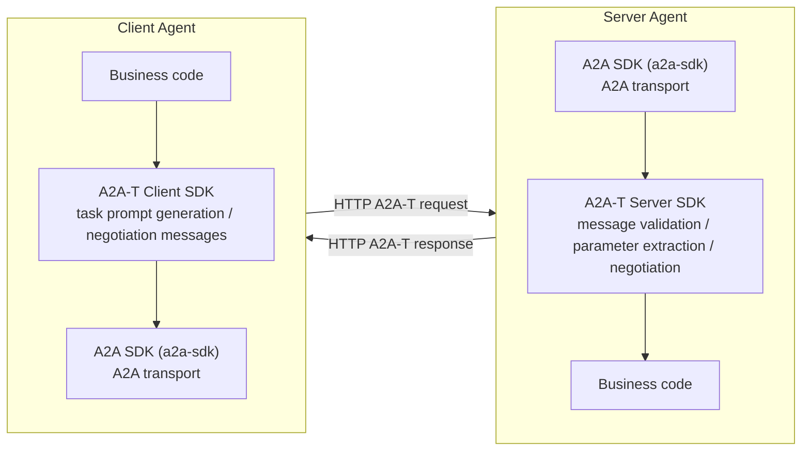

# a2a-t-sample —?Sample Use Cases

Sample use cases built on **a2a-t-sdk**, organized as sibling use-case directories.

## Directory Structure

        http://www.apache.org/licenses/LICENSE-2.0

   Unless required by applicable law or agreed to in writing, software
   distributed under the License is distributed on an "AS IS" BASIS, WITHOUT
   WARRANTIES OR CONDITIONS OF ANY KIND, either express or implied. See the
   License for the specific language governing permissions and limitations
   under the License.
-->

# a2a-t-sdk-python

<p align="center">
  <a href="https://www.python.org/"></a>
  <a href="LICENSE"></a>
</p>
<p align="center">
  <strong>Python SDK used to generate task prompts and handle task negotiation flows based on the A2A-T protocol.</strong>
</p>
<p align="center">
  <a href="./README_zh.md">中文</a>
</p>

---

## Project Overview

A2A-T (Agent-to-Agent Telecom) is a telecom-domain multi-agent interconnection protocol extended from the A2A protocol. It enhances capabilities such as information models, task negotiation, and collaboration security for telecom business scenarios, supporting deterministic, highly reliable, efficient, and secure collaboration among multi-agents in the telecom domain.

`a2a-t-sdk-python` is the Python SDK of the A2A-T protocol. Its core responsibility is to **generate, validate, and negotiate task prompts** (structured protocol messages) in A2A-T interactions. The SDK primarily targets two kinds of users:

- **Client Agent**: converts natural-language or structured input into task prompts conforming to the A2A-T format, and initiates, receives, and advances negotiation flows.
- **Server Agent**: validates whether A2A-T messages submitted by clients satisfy scenario, template, and slot constraints, extracts parameters, and advances negotiation flows.

The A2A-T SDK is independent of the A2A SDK. Using the two SDKs together builds agents with full A2A-T protocol support (the A2A SDK to pair with in the Python ecosystem is `a2a-sdk`):



## Core Capabilities

| Capability | Description |
| --- | --- |
| Task prompt generation (client) | Covers input normalization, scenario recognition, slot extraction, and template rendering, supporting both natural-language and structured-data input |
| Message validation and parameter extraction (server) | Executes metadata parsing, slot extraction, and semantic validation on SDK-format task prompts, extracts parameters per a Schema, and returns details of missing/invalid slots |
| Negotiation content API | Supports `information` / `feasibility` / `target` negotiation types plus `abort` termination messages, with template-driven negotiation message generation and validation; negotiation session state travels in the message metadata (`negotiationContext`) and the SDK itself is stateless |
| Resource organization | Bundled prompt resources (`prompts` / `scenarios` / `slots` / `templates` / `negotiation-vocabulary`) ship with the package, supporting both `packaged` built-in resources and `local_file` local files |
| LLM adaptation | Connects to external LLMs through OpenAI-compatible call chains, retrying retryable error codes up to the configured attempt limit |
| Bundled samples | The repository ships runnable sample scenarios such as `subscribe_incident` (event subscription); without an API key they automatically degrade to scripted mock LLM responses, running end to end with zero external dependencies |

## Project Structure

The repository is organized with `uv`; the core code lives under `src/a2a_t`:

| Module | Description |
| --- | --- |
| `client` | Client wrapper providing task prompt generation and negotiation entry points (`A2ATClient`) |
| `server` | Server wrapper providing A2A-T message validation and negotiation entry points (`A2ATServer`) |
| `core` | Template addressing, metadata models, the validation pipeline, and the structured bilingual error model |
| `common/prompt_resources` | Bundled prompt resource packaging and loading (`packaged` / `local_file`) |
| `config` | `.env`-based configuration loading and configuration models |
| `llm` | LLM adaptation layer with a default OpenAI-compatible client; supports custom LLM integration |
| `prompt` | Prompt resource analysis, slot extraction, template rendering, and validation |
| `negotiation` | Negotiation content models, the generation pipeline, and the validation pipeline |
| `a2a-t-sample` | Runnable client/server sample case collection |
| `a2a-t-corpus` | Accuracy verification corpus (pure test assets): data-driven workflow cases |

The `tests/` directory mirrors the package structure, covering prompt generation, server validation, negotiation pipelines, prompt resources, and LLM adaptation test cases.

## Quick Start

### Environment Requirements

| Item | Requirement |
| --- | --- |
| Python | `>=3.12` |
| Dependency manager | `uv` (recommended) |
| LLM | Optional. Without an API key the samples automatically degrade to scripted mock LLM responses, running with zero external dependencies |

### Run the First Demo in Three Steps

Take the `subscribe_incident` (event subscription) scenario as an example: the client generates a Notification-T task prompt from natural-language input and sends it to the server over a real HTTP A2A chain; the server validates the message, establishes the event subscription, and streams Incident notifications. All commands below run in the **`a2a-t-sample` directory** (where `.env` lives):

```bash
# 1. Install dependencies and prepare the environment configuration
#    (an empty A2AT_LLM_API_KEY automatically uses the mock LLM)
#    First run: execute uv sync --dev in the repository root (this creates .venv
#    and installs the SDK dependencies), then run the following in a2a-t-sample
cp env.example .env      # after copying, confirm A2AT_LLM_API_KEY is empty
uv pip install -r requirements.txt

# 2. Terminal 1: start the registry center (port 5001)
#    Set the module search path first (.env lives in a2a-t-sample):
#    PowerShell: $env:PYTHONPATH = "$pwd\fault-management\src"
#    bash:       export PYTHONPATH="$(pwd)/fault-management/src"
uv run python -m agentcard_example.registry_main

# 3. Terminal 2: start the server (port 8000);
#    Terminal 3: start the client (keeps receiving artifacts, Ctrl+C to stop)
#    Set PYTHONPATH in both terminals as in step 2
uv run python -m server_example.server_main
uv run python -m client_example.client_main
```

After startup you can observe the full-chain logs: client scenario recognition and slot extraction, the generated task prompt, the A2A request message, the server validation result, and the Incident notification push.

> If the Windows console shows garbled Chinese characters, run `chcp 65001` first.

### Connect a Real LLM (Optional)

Edit `a2a-t-sample/.env` and fill in any OpenAI-compatible endpoint:

```properties
# LLM protocol type
A2AT_LLM_PROVIDER=openai
# Model name
A2AT_LLM_MODEL=<model name>
# Model endpoint
A2AT_LLM_BASE_URL=<OpenAI-compatible endpoint>
# LLM API key
A2AT_LLM_API_KEY=<your API key>
```

See the repository root `env.example` for the full configuration reference.

### Development and Testing

```bash
cd {project path}/a2a-t-sdk-python
uv sync --dev
uv run pytest        # run all tests
uv run ruff check .  # static checks
uv run mypy src      # type checks
```

More runnable samples (event subscription end-to-end, negotiation closed loop, etc.) are described in [a2a-t-sample/README.md](a2a-t-sample/README.md).

## More Documentation

| Document | Location | Content |
| --- | --- | --- |
| Developer Guide | [docs/en/developer_guide.md](docs/en/developer_guide.md) | Feature introduction, installation and integration, parameter configuration, and minimal practices |
| API Reference | [docs/en/API_Reference.md](docs/en/API_Reference.md) | Full API definitions and usage of `A2ATClient` / `A2ATServer` |

## Current Support Scope

Confirm the following limitations before use:

- The built-in LLM call chain is uniformly exposed as an OpenAI adaptation layer.
- The LLM prompt resources are built in and do not support custom extension (`prompts` and `errors` are always read from the built-in resources).
- Negotiation session state travels in the message metadata (the SDK is stateless) and no negotiation state store is provided; the legacy state-machine negotiation APIs (`start_negotiation` / `receive_negotiation` / `continue_negotiation`) are deprecated since 1.1.0.
- Bundled resources and language coverage are limited, and remote resource loading such as `registry-center` (the registry center) is not included.
- This document mainly introduces the SDK itself and does not cover CLI tools, hosted services, deployment flows, or ready-to-use application solutions.

## Quick Start (shared)

```bash
cd a2a-t-sample
cp env.example .env
uv pip install -r requirements.txt
```

> If `A2AT_LLM_API_KEY` is left empty in `.env`, the samples automatically use mock LLM responses from `resources/mock_responses/`. No real API key is needed to run the full flow.

## Use Case: observability-sample

A runnable sample that shows the full lifecycle of an A2A-T interaction - client asks, server answers, artifacts stream back - with every step automatically traced, measured and logged by the SDK observability layer. Three scenarios (native / a2at / negotiation) demonstrate the real negotiation timing: offer rounds happen over bare messages and the task starts only after agreement. Optional Langfuse backend puts every round and the task on one browsable trace.

See \2a-t-sample/observability-sample/README.md\ (en) and \README-zh.md\ (zh) for the walkthroughs.

## Use Case: subscribe-incident

A minimal end-to-end use case demonstrating the **subscribe-incident (fault subscription)** scenario: client generates prompt -> server validates -> streaming Incident artifact push. The flow includes client-side prompt generation, server-side validation, and streaming artifact push, while retaining the LLM mock capability.

### Start services (three terminals)

> Modules live under `subscribe-incident/src/`, while the `.env` file is at `a2a-t-sample/`. Therefore you must set `PYTHONPATH` to point to `subscribe-incident/src` **from the `a2a-t-sample` directory**.

```powershell
# Change to the sample directory (where .env lives)
cd a2a-t-sample

# Set module search path (every terminal needs this)
$env:PYTHONPATH = "$pwd\subscribe-incident\src"
```

```bash
# Terminal 1: start registry (port 5001)
uv run python -m agentcard_example.registry_main

# Terminal 2: start server (port 8000)
uv run python -m server_example.server_main

# Terminal 3: start client (receives artifacts continuously; Ctrl+C to stop)
uv run python -m client_example.client_main
```

The client will continuously receive artifacts. Press `Ctrl+C` to stop.

### Limit received count (optional)

```powershell
$env:A2AT_SAMPLE_MAX_ARTIFACTS = "5"
uv run python -m client_example.client_main
```

### Flow

| Stage | Who calls SDK | What SDK does | LLM calls |
|-------|--------------|---------------|-----------|
| Startup | client + server | A2ATClient / A2ATServer init | 0 |
| Prompt generation | client | scenario recognition + slot extraction + template render | 2 |
| Prompt validation | server | scenario recognition -> slot extraction -> semantic validation | 3 |
| Streaming push | client | normalize_event for stream events | 0 |

### Message Body Convention

The A2A request sent by the client follows this convention:

| Field | Content |
|-------|---------|
| text part | scenario name (`"create incident subscription"`) |
| `metadata[Notification-T/NL/v1]` | generated promptText |
| header `A2A-Extensions` | `https://projects.tmforum.org/a2aproject/telecommunication/extensions/Notification-T/NL/v1` |

- Prompt generation input is a **hard-coded natural language string**, selected by `A2AT_LANGUAGE`:
  - `zh-CN`: `"请生成一个Incident事件订阅任务：通知主题为Incident，订阅条件为critical的ETH-LOS的故障，上报通知数据格式为DataPart"`
  - `en-US`: `"Generate an Incident event subscription task: notification topic is Incident, subscription condition is a critical ETH-LOS fault, and the notification data format is DataPart"`

### Server Validation Flow

The `execute_server_flow` state machine:

1. **Validate `A2A-Extensions` header** —?must contain the Notification-T/NL extension URI; otherwise throws `ValueError("a2a client extensions is not exist.")`
2. **Extract promptText from `metadata[Notification-T/NL/v1]`** (no longer reads from `parts[0].text`)
3. **`SUBMITTED`** 鈫?call `A2ATServer.check_task_prompt` for validation
   - Validation fails 鈫?emit **`REJECTED`** status (not an exception)
   - Validation passes 鈫?emit **`WORKING`** status
4. **Loop pushing Incident artifacts** (every `ARTIFACT_SEND_INTERVAL_SECONDS = 5.0s`, infinite by default, can be capped via `max_artifacts`)
5. Exception during push 鈫?emit **`FAILED`** status

### AgentCard Data

- name: `SPN Domain Agent`, provider: `Huawei`
- Declares only the `Notification-T/NL/v1` extension (subscribe use case does not involve Task-T)

### Key Points

- **SDK as middleware**: client/server never call LLM directly; they go through A2ATClient/A2ATServer
- **LLM only for prompt phase**: no LLM calls during artifact push
- **No negotiation**: client submits complete input; server validates and pushes directly
- **Three-layer decoupling**: client (discover + consume) -> server (register + push) -> registry (registry center)
- **Mock capability preserved**: `common/mock_llm.py` + `resources/mock_responses/` auto-activate when the API key is empty; the full flow runs without a real API
- **How to tell it's mock**: before each mock LLM response, a standalone log line `[llm] llm-mock: using canned mock LLM response` is printed; this line is absent when using a real LLM

## Run Tests

```bash
# Run all use case tests (from the a2a-t-sample directory)
uv run pytest subscribe-incident/test/ -v
uv run pytest negotiation/test/ -v
```

## Use Case: negotiation

An **offline** negotiation closed-loop demo (the Python counterpart of the Java
`a2a-t-sample` NegotiationDemoApp, with the embedded HTTP server replaced by an in-process
runtime call). It drives the 4-message flow:

1. client -> Task-T prompt generated with **missing** params (`generate_task_prompt_from_data_with_schema`);
2. server -> `validate_task_prompt_and_data_filling` rejects (params missing) -> Negotiation-T
   information **propose** -> `INPUT_REQUIRED`;
3. client -> Task-T prompt with **filled** params + Negotiation-T **accept**;
4. server -> validation passes -> diagnosis result -> `COMPLETED`.

### Run (offline, no API key needed)

```bash
# From the a2a-t-sample directory; PYTHONPATH points at the use case src
$env:PYTHONPATH = "$pwd\negotiation\src"     # PowerShell; export PYTHONPATH=... on bash

uv run python -m negotiation_demo                 # fromData strategy (deterministic negotiation messages)
uv run python -m negotiation_demo --fromText      # fromText strategy (one LLM extraction per negotiation message)
uv run python -m negotiation_demo --language zh-CN
```

Without `A2AT_LLM_API_KEY` in `.env`, the scripted mock LLM (`negotiation/src/negotiation_demo/shared/mock_llm.py`)
serves the slot-extraction, content-validation and negotiation-extraction calls from
`negotiation/resources/mock_responses/`, so the whole round trip runs offline. With a real API
key the same flow calls the real LLM (the negotiation messages of the fromData strategy still
make no LLM call —?the SDK renders the typed content directly from the template).

### Flow

| Stage | Who calls SDK | What SDK does | LLM calls (fromData) |
|-------|--------------|---------------|----------------------|
| Message 1 | client | Task-T slot extraction + template render (`fromDataWithSchema`) | 1 |
| Message 2 | server | `validate_task_prompt_and_data_filling` + negotiation propose generation | 1 (+0 fromData) |
| Message 3 | client | Task-T generation + negotiation accept generation | 1 (+0 fromData) |
| Message 4 | server | `validate_task_prompt_and_data_filling` + diagnosis rendering | 1 |
